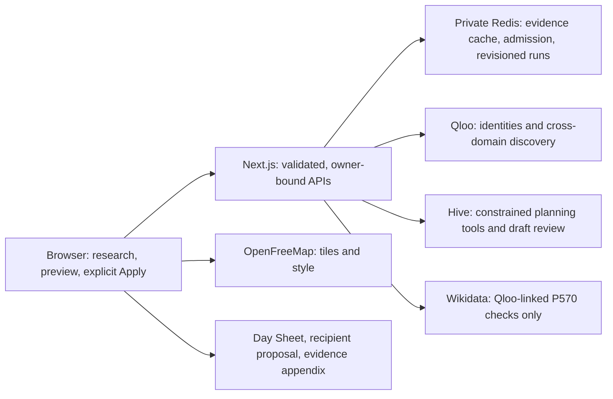

# TourPulse

Build a tour-research shortlist you can explain: discover audience-led markets and rooms, record deciding constraints, compare schedule changes, and prepare a conditional sponsor proposal. Built for the [Qloo Agentic Hackathon](https://qloo.devpost.com/). This is initial research and outreach preparation, not a booking or demand-forecasting system.

**Live application:** https://tourpulse-six.vercel.app

**Submission:** [TourPulse on Devpost](https://devpost.com/software/tourpulse), submitted to the Qloo Agentic Hackathon on October 25, 2026. [Download the 2:22 product walkthrough](https://github.com/NL-Hackerton/tourpulse-public/releases/download/submission-2026-10-25/tourpulse-demo.mp4). The hosted app is the primary demonstration; the video is edited, sampled footage of real browser sessions.

**Source:** https://github.com/NL-Hackerton/tourpulse-public — an audited snapshot with non-identifying commit metadata. Private development history, credentials, raw provider responses and operator evidence are not included.

The hosted application requires **no visitor account or API key entry**. Its server uses operator-managed credentials. Keys in the local setup below are required only when running your own copy; never publish a live credential with the source.

## Product workflow

1. Load a real cached **Music**, **Stand-up** or **Live podcast** preset, or search for a compatible headliner and up to four cultural anchors.
2. Choose dates, target seats, departure city, stop count, daily driving and either a compact schedule or a Thursday–Saturday preference. Plan a two-to-six-stop research route.
3. Start with the research queue. Inspect each lead's taste evidence, record a public source for an operating constraint, and **shortlist, hold or exclude it with your own reason**. These judgments are separate from provider facts and bookings.
4. Choose a venue for the working route. Excluding the selected venue clears it; excluded rooms cannot be selected or reused as sponsor activation suggestions until the user reviews or explicitly forgets the assessment. Previous candidates remain in an inspectable history when results change.
5. Ask the agent for a change. Date, driving-hour and show-day policy previews show actual before/after days and city dates using the same scheduler as Apply. Provider-dependent outcomes are explicitly unknown until recalculation. **Preview never applies a change.**
6. Select a sponsor, then save the proposal purpose and constraints. On-site activation requires an explicitly selected target market and a non-excluded venue in that market. In-kind touring essentials and tour-support discussions use route-wide context without requiring a venue. Unsaved preferences cannot silently change a draft. Recipient prose and the full evidence appendix have separate Markdown and print exports. No email is sent.
   Taste discovery alone does not show that a brand is a practical counterpart for the saved purpose. Each sponsor card shows **Fit for saved purpose: Not reviewed, Worth discussing or Not suitable**. The user records what a public source shows the brand offers for that purpose and their own reason. "Not suitable" blocks drafting to that brand for that purpose. "Worth discussing" grounds the conditional support request in the user-sourced offering, which is never presented as the brand's availability, willingness or agreement. An unreviewed brand still drafts a generic request, flagged in the draft's limits. Checks survive recalculation; a brand that is no longer returned keeps its check, marked as outside the current candidates. The assistant cannot record or forget these checks.
7. Export the current feasible revision as Markdown, spreadsheet-safe CSV or print. Changed inputs make the previous result read-only; Undo restores a previous owned snapshot.

Music support candidates are artists. Stand-up candidates require verified comedian taxonomy. Live podcast distinguishes program crossovers from individual guest comics. **Every support kind** resolves its bounded discovery set through Qloo `/entities` before ranking: recorded deaths and missing or wrong-type detail records are withheld. Headliners are also checked before city planning; historical entities may remain cultural anchors.

When a detail record includes a Wikidata ID, the server checks that exact ID's **P570 (date of death)** statements through the public Wikidata API. It never searches by a person's name or asks an LLM to infer life status. Explicit item redirects are accepted only when their returned `from` and `to` match the requested and resolved IDs. Deprecated statements are ignored; preferred statements take precedence; an unknown-date death statement still withholds the candidate. Lookup failures stop the operation rather than inventing a checked result.

Wikidata evidence has its own provider label, timestamp and source links. It is **biographical eligibility context**, not evidence for Qloo names, affinity, venue facts or sponsor claims. Records without a Qloo-linked Wikidata ID remain explicitly unverified on each support card. Absence of a death record is **not** proof of life, current activity, willingness or availability; group dissolution and podcast production status are not verified by P570. Venue and support selections remain research leads, not bookings.

Venue and nearby-partner discovery never offers places Qloo tags as adult-entertainment clubs; when Qloo returns one, the market's operating notes record that it was withheld. User-sourced checks must cite a public web address: local-network hosts, IP addresses and credentials are rejected.

The model writes four bounded content blocks: activity, support request, prospective value and next step. The application composes the factual introduction, title and email from those blocks and verified fact references; it does not invent a sender identity. The full composed document still passes reference checks and a separate factual/readiness review. Requests and explicitly proposed activities are distinguished from claims of existing bookings, resources or sponsor commitments.
Recipient proposal printing uses portrait A4 and does not repeat the email draft. The email remains available in its own tab and text export; the separate evidence appendix preserves all generated copy, citations and limitations. The Day Sheet retains landscape A4, a TourPulse masthead, a not-a-booking label and page footers. It opens with inline route metrics, a straight-line route sketch from verified coordinates, and a daily-drive bar chart against the user's cap, followed by one card per market and the itinerary. The screen's Overview tab uses the same metrics and chart components; Day sheet and Map and neighborhoods are separate working views. Candidate cards show 0–1 signals as labeled bars with their values.
The Day Sheet includes current venue judgments, source-linked operating notes, their check dates and date applicability, and explicit missing/reconfirmation states. The evidence appendix groups identical facts and references email paragraphs only when their text is exactly identical; it retains all fact IDs, source parameters and original timestamps. A returned but unselected venue is distinguished from a market with no venue candidates.

### Judgments are not scores

Qloo taste signals help discover leads; source-linked checks and the user's judgment decide what to investigate next. A recorded capacity, operating, availability or fee note is not automatically treated as a successful check. Date-mismatched and stale notes are marked for reconfirmation. Changes to audience, target size, show dates or recorded findings flag affected judgments for review.

Each market retains up to twelve venue assessments, including historical candidates. The history shows the original venue name and source notes, and users can explicitly forget an assessment without abandoning the plan. No exclusion is silently discarded when a candidate leaves the current results. Forgetting an exclusion makes it eligible again but never selects it automatically.

Published venue configurations can change a research decision: [Paradise Rock Club's private-events sheet](https://cdn.shopify.com/s/files/1/0322/4584/1965/files/2024_Paradise_OneSheet.pdf) lists theater capacity 250, while [House of Blues Boston's official table](https://specialevents.livenation.com/venues/house-of-blues-boston) lists Music Hall theater capacity 850. These configuration-specific figures do not establish current date availability or fees. They illustrate why a 500-seat requirement cannot be inferred from cultural affinity or standing-room capacity. This is a desk-review example, not a participant study or booking outcome.

## Run locally

Use Node.js 22 or newer and npm (checked: typecheck, tests, build and start on Node 22; typecheck and tests on Node 26). Dependencies are pinned in `package-lock.json`.

```sh
npm ci
cp .env.example .env.local
chmod 600 .env.local
# Populate every server credential in .env.local; never commit this file.
npm run dev
```

Open http://127.0.0.1:3000. The server requires:

| Variable | Purpose |
|---|---|
| `QLOO_API_KEY` | Your Qloo hackathon credential |
| `QLOO_BASE_URL` | Fixed `https://hackathon.api.qloo.com` origin |
| `HIVE_API_KEY` | Hive organization credential with model access |
| `AI_MODEL` | Default `deepseek-ai/deepseek-v4.1-flash-1017` |
| `SESSION_SECRET` | Cryptographically random secret of at least 32 characters |
| `JUDGE_ACCESS_CODE` | Optional private judging-priority credential, at least 32 random characters |
| `CRON_SECRET` | Private operator credential of at least 32 random characters for scheduled sample maintenance |
| `KV_REST_API_URL`, `KV_REST_API_TOKEN` | Private Upstash REST bindings supplied by the Vercel integration |
| `NEXT_PUBLIC_MAP_STYLE_URL` | Optional public MapLibre-compatible style; no secret credential |

No server credential uses a `NEXT_PUBLIC_` variable. HTTPS is mandatory outside localhost; deployed cookies are HttpOnly, Secure and SameSite=Strict. Sessions and owned runs expire after 48 hours. Export important work. Session reset deliberately creates a new identity and does not recover the old identity's runs.

### Operator-only preset warming

```sh
npm run warm:samples -- --start-date=2026-11-05 --mode=all
```

This resolves canonical entities and generates genuine Qloo plans for all three modes in private shared Redis. It consumes real API quota. Shared examples expire after seven days. Loading an example copies it into a new owned run and preserves source timestamps. Illustrative selections remain unconfirmed and editable. If no shared sample exists, the UI loads verified preset inputs rather than fabricating a completed tour.

`vercel.json` schedules the authenticated `/api/cron/warm` route daily at 02:17 UTC. Vercel Hobby execution may occur within that hour rather than at the exact minute. Set `CRON_SECRET` in the deployment environment; unauthorized requests receive 401. The route warms all three modes with a start date seven days ahead, uses public shared execution capacity rather than reserved judging slots, and stops automatic provider work after November 6, 2026 at 04:45 UTC. Local authenticated execution completed all three modes; the deployed schedule still requires verification. No model-generated sponsor proposal is included in maintenance.

## Architecture and boundaries




- **Browser:** React console, accessible Radix dialogs/tabs, MapLibre vector map and equivalent stop/neighborhood lists. OpenFreeMap tiles are requested directly by the browser with visible OpenFreeMap, OpenMapTiles and OpenStreetMap attribution. Tile data are not proxied or collected into the Qloo cache.
- **Next.js server:** validated search, preset, sample, planning, action, preview, proposal and run lifecycle routes. Qloo and Hive hosts are fixed server-side; redirects are rejected.
- **Shared Redis:** private Qloo response cache, identical-request leases, per-provider admission and versioned owned run snapshots. There is no uncoordinated memory/disk fallback when Redis fails.
- **Qloo:** actual search, entity resolution, destination/place/support/brand insights and audience comparison. Heatmap permission failure uses actual place-page geohash aggregation, explicitly labeled as a proxy rather than invented heatmap output.
- **Hive model:** real entity/tag lookup and constrained action tools. Sponsor drafting preflights actual audience comparison, exposes a focused subset of source facts, derives citations from descriptive placeholders, and validates both factual support and recipient readiness in an independent model call. Field-specific failures return to the same author conversation for bounded correction. No template is presented as a successful model response.

`POST /api/plan`, `/api/apply` and run retry return NDJSON `accepted`, `trace`, `result` or `error` events. A result is emitted only after its token/version-protected shared commit. `GET /api/runs/:id` restores owned state; `DELETE` fences an unfinished run. An expired execution lease becomes interrupted and can be retried against shared cached evidence. Provider work already completed before cancellation may remain cached. Client-side stopping of an AI response is not represented as a guaranteed provider refund or termination.

Mutation requests require a matching Origin and reject cross-site fetch metadata. BotID Basic verifies browser requests before protected API work; the client and server explicitly select the free Basic level. The official SDK's local-development allowance is not production verification. Production requires Vercel's BotID challenge routes; bare local `npm start` is not a substitute for the deployed protection test. Inputs, provider payloads, model steps and execution durations are bounded. Errors do not return credentials or raw upstream bodies. Public health reuses a timestamped dependency observation through Next Data Cache for 30 seconds, including unavailable results; it does not issue a fresh Redis PING per read.

## What the scores mean

City Fit blends destination rank and returned venue/partner affinity. Support and sponsor comparisons use the same retained place IDs; incomplete or sensitive comparisons withhold composite superiority and preserve discovery ordering. These are exploratory ranking heuristics, **not** compatibility probabilities, ticket-demand forecasts, booking tiers or sponsor intent.

Market and sponsor cards expose the headliner-only audience-discovery rank next to the rank with all cultural anchors. Unchanged and unavailable comparisons remain visible; no uplift is invented. Anchor Delta is a comparison of the complete bundle, not individual causal attribution or proof of better business outcomes. Heatmap contributions are grouped by entity type. The niche slider previews scores locally without issuing new Qloo requests.

Geographic requests use verified coordinates and a 30 km response boundary, not ambiguous city-name geocoding. Missing coordinates are excluded. Destination country evidence comes from Qloo metadata; fixed catalog destinations can also use a name/alias and coordinate-verified country fallback, labeled as catalog evidence. Unknown outside-catalog countries are rejected rather than inferred from a city name. Driving distance is an adjusted haversine estimate (×1.25), with time calculated at 90 km/h, not measured road routing. The scheduler enforces daily driving and mandatory rest after five consecutive shows; preferred weekdays are soft constraints. Infeasible windows return actionable changes and no exportable itinerary. Lodging, venue capacity, current operations, availability, fees and accessibility require direct checks. Target seats are user input, not verified venue capacity or expected attendance.

## Data, operation and release limits

Raw Qloo responses stay in private Redis for seven days and must not enter public source, fixtures, logs or documentation. Exports are derived working documents with source evidence, not raw API dumps. No response is promoted to a public preset through a guest mutation endpoint.
Qloo response cache entries use lossless gzip/base64 in the `v3` cache namespace, with bounded decompression. The payload, source timestamp and freshness policy are unchanged; run/sample JSON and shared dispatch coordination are separate. Older response-cache entries are not a runtime fallback. Reduced wire size addresses observed concurrent large-GET timeouts without extending the storage deadline.

The current persisted run/sample contract and browser saved-run keys use version 10, preventing earlier unscreened samples from reappearing as current leads. Earlier private-development namespaces are not read and expire under their existing TTL; they are not deleted or silently coerced. Rewarm canonical samples after a cutover. Saved proposal purpose, target market, constraints, sponsor checks and historical research remain part of the contract. Returning candidates recover their research notes for review; exclusions remain effective and old selections are not restored. Explicit forgetting removes only the listed historical records. Shared canonical samples reject all user research, including archives and sponsor purpose checks.

Wikidata requires no additional credential. Requests use only Qloo-provided, syntactically validated Q-IDs, at most 20 per batch, a fixed HTTPS endpoint, bounded response reading and shared server-side dispatch spacing. HTTP redirects are rejected; Wikidata's explicit item-redirect metadata is distinct. Compact P570 results use a separate compressed private cache with a seven-day TTL and preserve their original fetch time. No user name, planning prompt, research note or credential is sent to Wikidata. Free access remains subject to upstream availability and throttling, not a guarantee of unlimited service.

The [official hackathon developer guide](https://docs.qloo.com/reference/qloo-llm-hackathon-developer-guide) permits private server-side caching without a retention limit and states that hackathon keys remain active through judging. The seven-day cache is this application's operating policy, not a Qloo retention requirement. Key validity does not remove provider quotas.

Shared execution admission allows six active operations, at most four public operations, with reserved capacity and FIFO priority for signed judging sessions. Short waiting tickets are bounded (24 public, eight judging, at most 12 seconds); overload returns a recoverable response rather than keeping unlimited HTTP requests open. There is no cumulative usage quota. The optional code in private judging instructions grants an owner-bound HttpOnly priority cookie, not additional features or exemption from provider limits. Resetting the anonymous identity invalidates its priority association. Sample adoption uses an owner/mode/request identifier to deduplicate transport replays; distinct intentional requests are not described as deduplicated.

Provider dispatch uses Redis grant spacing of 1260 ms and a conservative 1000 ms consumption window measured before the Redis round trip. Late grants are discarded, and no await separates the final freshness check from `fetch`. Under a normally advancing Redis clock, one authoritative coordinator and uninterrupted final dispatch, valid windows leave at least 260 ms between calls. Arbitrary clock jumps, state loss/failover, network delivery, OS preemption after the final check and external users of the same credential are outside that guarantee. Work release aborts sibling provider requests before returning its slot; stale work cannot make further calls through the context boundary.

Finite Qloo, model, hosting and Redis allocations still govern availability. BotID Basic mitigates ordinary direct-script abuse, not all sophisticated browser automation or cumulative cost abuse. No visitor payment or per-judge usage counter is implemented, but sufficient resources through the judging period have not yet been established.

Keeping verification private until submission reduces pre-event exposure; it does not remove cumulative resource-exhaustion risk after publication. The current protection does not claim to prevent all repeated use by browser-admitted visitors. No additional anonymous usage quota was introduced by the private-release decision.

The configured model provider is Hive, not Vercel AI Gateway. An existing credential was reused; the Gateway card-verification route was not enabled. Upstash was provisioned as a free native Vercel integration with automatic upgrade disabled. No paid upgrade is implied by this README.

The application document uses a fresh per-request CSP nonce and dynamic rendering. Production scripts are restricted to the same origin or the request nonce; inline event handlers and string evaluation are not allowed. Connections and map images are restricted to the same origin and the configured map-style origin (OpenFreeMap by default). Styles retain `unsafe-inline` for MapLibre positioning and component styles, not script execution. A custom style must serve its tiles, sprites and glyphs from that same allowed origin. Document responses are private and non-cacheable so nonces cannot be reused by a CDN. API responses retain the baseline frame/object/base restrictions.

The October 25 official-rules update ends judging on November 5, 2026 at 23:45 EST (November 6 at 04:45 UTC). Automatic sample maintenance stops after that boundary. The top three finalists must be available for the November 5 broadcast and preparation.

## Verification

```sh
npm run typecheck
npm test
npm run build
npm start
# Opt-in real Redis checks; use a private test-capable database, never FLUSHDB:
TOURPULSE_REDIS_TESTS=1 node --env-file=.env.local --conditions=react-server --import tsx --test src/lib/operations.test.ts
```

### Release candidate — October 25, 2026

- The screen and all three print documents now share the Tremor Planner-inspired design recorded in `DESIGN.md`. No reference code or assets were copied. Route order, inline metrics and the daily-drive chart use shared components.
- TypeScript, 116 deterministic checks (122 total; six opt-in Redis checks skipped), the production build and the production dependency audit passed. The audit reported zero known vulnerabilities; this is not a guarantee against undiscovered defects.
- A protected deployment exercised the real cached Music sample, map rendering, Hive preview, Apply, Undo, saved proposal purpose and a newly generated Hive proposal. The 4-to-3-hour preview predicted one additional travel day; Apply produced revision 2 with two travel days, and Undo restored revision 1 with one.
- An injected inline script without the request nonce did not execute. Map rendering, BotID-gated actions and proposal generation produced no additional observed CSP violation. This is a bounded browser check, not a penetration-test guarantee.
- New recipient proposal (1 page), evidence appendix (8 pages) and Day Sheet (2 pages) PDFs were generated from that deployment and every page was visually inspected. The appendix's last page is sparse but contains two required Wikidata source records. Native print dialogs, physical devices and screen readers were not tested.
- The updated automatic-maintenance cutoff was exercised after the new judging-end boundary: an authenticated request returned `judging-period-ended` without provider work; a request without operator authentication remained denied.


### v10 linked biographical checks — October 23, 2026

- A real artist diagnostic showed why Qloo detail lookup alone was insufficient: all 20 returned artist detail records lacked `date_of_death`, including historical performers. Their Qloo-linked Wikidata checks withheld 17 candidates with recorded deaths. Three remained: two linked records without a death statement and one candidate without a linked ID, explicitly unverified. This deliberately historical-seed diagnostic is not a representative accuracy or user-impact estimate.
- A real Frank Sinatra headliner request was rejected before city planning through its linked biographical record. A second lookup reused the original timestamp with `cached: true`.
- The first canonical warming attempt failed closed on a legitimate Wikidata item redirect. Explicit from/to validation and regression coverage corrected it; subsequent real warming completed Music, Stand-up and Live podcast in the v10 namespace.
- TypeScript and 116 deterministic checks passed (122 total, six opt-in Redis tests skipped); all six real Redis checks also passed separately. Tests cover every support kind, missing and wrong-type details, upstream failure, P570 rank/snak semantics, identity redirects and separation of biography checks from facts rendered into proposal prose.
- Protected UI observations confirmed linked status on Music cards, explicit unlinked status on stand-up cards, separate Qloo/Wikidata source entries, all three presets and a real Hive Music proposal. No external participant or real-world conversion evidence was added.
- Final deployed outputs were regenerated after correcting fact attribution: the 62-fact Music proposal contains no Wikidata citation on a Qloo fact, while the independent biographical checks remain in the audit register. The recipient proposal (one page), evidence appendix (eight pages) and Day Sheet (two pages) were rendered and all 11 pages inspected. The last appendix page is sparse but retains both Wikidata requests. Exact hashes and page observations are in the contest repository's private `eligibility-v10/final/review.json`.

### v9 eligibility and interaction correction — October 23, 2026

- A real SmartLess sample exposed a deceased guest candidate. Its Insights row omitted biographical details, while Qloo `/entities` supplied `date_of_death`. Person recommendations now inspect those details before truncating and ranking the eligible set; a failed detail lookup fails the operation rather than silently treating the record as unavailable. No person-name blacklist, language-model biography guess or inferred availability is used.
- Strict TypeScript and 104 deterministic checks passed (110 total; six Redis checks skipped in that command). Regression checks cover deceased and unresolved guests, eligible replacements, failed detail retrieval, and rejection of a deceased headliner while preserving cultural-anchor use.
- Desktop reconnect remains visible when activity is collapsed. All five route summaries remain available at narrow widths. Date fields stack when the setup column is too narrow; small agent/map controls have 32px minimum heights and coarse-pointer controls use 44px targets. The anchor comparison's whole-bundle caveat is visible rather than hover-only. The route sketch has a bounded screen height so its labels do not shrink with a narrow column.
- On the protected pre-eligibility correction preview, real Music Preview → Apply changed the four-hour drive cap to three hours, matching five → six calendar days and one → two travel days; Undo restored the original revision. All three real cached presets loaded. A real Hive podcast proposal was generated and saved. These observations exposed the guest-eligibility defect; they are not a clean final release result.
- Browser automation sometimes reported a click without changing the DOM, and oversized off-screen captures repeated image tiles. DOM activation and a capture size within the embedded surface were used for the recorded flow. This is not physical-input, mobile-device, screen-reader or participant-study evidence.
- After the v9 correction, all three canonical samples were regenerated through real Qloo and saved to private Redis. Six separately enabled real Redis checks passed and the protected deployment built successfully. Its actual SmartLess guest list contained Wanda Sykes, Ben Falcone and Joy Behar with the detailed `/entities` timestamp; the historical guest was absent.
- The corrected protected deployment loaded all three modes, restored the saved run via the visible Reconnect control and generated a new real Hive podcast proposal. Actual CSS viewports of 1067×717 and 325×703 showed all five summaries without document-width overflow, and date fields fit their columns. The resulting portrait recipient proposal (one page), landscape evidence appendix (seven pages) and Day Sheet (two pages) were each rendered and every page was visually inspected. Exact hashes and page notes are in `.private/polish-v9/final/review.json` in the contest repository; private evidence is not bundled into the public product source.

### Historical v8 verification — October 22, 2026

- Strict TypeScript, 99 deterministic checks (105 total; six opt-in Redis checks skipped) and six separately enabled real Redis checks passed. Canonical samples were rewarmed for the v8 namespace. Protected Vercel previews built successfully; no production alias was restored.
- An operator desk review recorded official-source venue checks and decisions in three modes: stand-up at a 300-seat target (Helium 250 seated excluded, Punch Line shortlisted, Bottlerocket 140 seated excluded, The 700 held), live podcast at 500 (The Fillmore shortlisted, Underground Arts 200 seated and Boston Center for the Arts at most 370 excluded, Walnut Street and Orpheum held) and music at 300 (The Sinclair 200–220 theater seating and Club Cafe excluded). Sources are in the contest repository's `research/desk-review-sources.md`. This is not participant research.
- Qloo returned an adult-entertainment club as a Pittsburgh music venue candidate and another as a Providence partner; both were withheld and noted in the market's operating notes.
- Sponsor purpose checks: across three runs of four fixed cases, every "Not suitable" check (9 of 9) blocked drafting with the user's reason. Before the correction below, two of four "Worth discussing" drafts failed, both on-site (one case failed both of its attempts): the full source note was inserted into prose and a malformed verifier response ended the author's turn. The offering is now a short phrase, and a malformed verdict returns to the author for a fresh check without approving anything. After the correction, 12 of 12 case drafts and 1 of 1 protected-UI draft completed on their first attempt. These are bounded observations with existing cache, not a reliability rate.
- The protected UI saved a Boston target, a no-attendee-signups constraint and a Warby Parker purpose check through the dialog, then generated the proposal. Its recipient proposal (one page), evidence appendix (six pages) and Day Sheet (two pages) were rendered by Chromium and every page was opened; native print was opened and cancelled.

### Print and overview visuals — October 22, 2026

- Typecheck, 100 deterministic checks (including a new check that every Markdown table has as many separator cells as header cells; the Schedule table previously had one extra) and a production build passed.
- The route-first layout introduced summary figures, route sketch, day strip and a compact venue-research queue. The original branch claimed an 11px screen minimum and 32px targets; subsequent real-browser inspection found exceptions in the map legend, scaled sketch labels and agent examples. The v9 correction above addresses those specific exceptions rather than treating the original claim as verified.
- The branch's initial Chromium and PDF checks used synthetic render-only fixtures. Subsequent protected-deployment testing used real cached Qloo plans and a real Hive draft; those observations are listed separately, not retroactively counted as the branch's original verification.
- The earlier current-layout PDF pass exposed a sparse third Day Sheet page and a historical guest candidate. The print overview was compacted without dropping source records; final-candidate page counts and visual review are recorded with their exact PDF hashes in the contest evidence bundle.

### v7 verification — October 22, 2026

- Strict TypeScript, 87 deterministic checks and six separately enabled real Redis checks passed. The protected Vercel preview built successfully; no production alias was restored.
- A fixed six-input protocol covered Music, Stand-up and Live podcast, all three proposal purposes, constraints, and a six-stop route. Three repetitions produced 18 observed trials: 17 completed on their first attempt; one proposal-stage failure completed on its single allowed full-input recovery attempt. First-attempt elapsed time ranged from 19.0 to 124.8 seconds, with a median of 31.5 seconds. These are domain-function observations using real providers and existing cache, not HTTP-session, participant or population reliability measurements. The failed attempt remains in the denominator.
- The protected UI saved a Boston target and a no-attendee-signups constraint, generated and persisted the corresponding Music proposal, and saved an official configuration-specific capacity check and venue exclusion. The selected venue was cleared and the itinerary reported an unselected venue rather than absent evidence.
- Final deployed print output was checked on every page: recipient proposal one portrait page, evidence appendix six landscape pages, and a source-linked Day Sheet two landscape pages. The earlier blank first page and preview-toolbar overlay were corrected. Print inputs were explicitly replayed real operator-owned results, not new generations. Native print was opened and cancelled; no physical printer output is claimed.
- Review corrections preserve multiline reference targets, prevent a removed market's check from appearing current for this route, and distinguish an unset proposal target from one that left the route.

### Historical observations — through October 21, 2026

- Strict TypeScript and 77 deterministic checks passed after the historical-note and compressed-cache corrections (83 total; six opt-in Redis checks skipped). Deployment builds and real-service smoke are recorded separately.
- Real Qloo generated all three canonical samples. Real Hive preview and sponsor generation were exercised; browser Apply changed daily drive from four to three hours and Undo restored four.
- Arbitrary inputs Alvvays (Music), Taylor Tomlinson (Stand-up) and 99% Invisible (Live podcast) each completed real Qloo planning, typed support/sponsor selections, independently checked Hive proposal generation and Markdown/CSV export. Stand-up exposed earlier structure/numerical-validation failures; bounded tool feedback was corrected before its successful generation. These successful examples are not a reliability-rate estimate.
- Two actual Node processes used real Redis and a controlled HTTP receiver with injected 1400 ms response delay and process pause. Each discarded its stale grant; four actual requests arrived with 1349–1564 ms gaps. Shared admission also held four public slots while admitting a judging operation and rejecting expired work before dispatch. These are bounded observations, not universal network guarantees.
- A temporary local Next route exercised failed-parent cleanup: its delayed sibling observed the aborted context and made zero requests to the controlled receiver. The temporary route was removed. Two actual health HTTP reads reused the same dependency-check timestamp.
- A genuine map canvas capture showed labeled geography, a market marker and the route. Whole-page captures intermittently omit the GPU layer, and Orca's native key/click transport has sometimes delivered no DOM event despite returning success. Complete physical-keyboard verification remains open; DOM-driven checks are not represented as hardware interaction proof.
- Actual local HTTP checks passed ownership isolation (404), cross-origin rejection (403), stale revision rejection (409), explicit cancellation, cancelled retry rejection and interrupted-run resume to a completed saved plan.
- The deployed browser loaded a private canonical sample through real BotID; unauthenticated direct script calls to search and sample adoption received 403. Local failed-run reload retained the earlier result read-only, focused the error, restored edited inputs and recovered the completed snapshot with exports enabled.
- Local actual Qloo/Hive checks completed a Montreal replacement, date change and precise sponsor-category filter; ambiguous category requests clarified instead of broadening the requested category silently.
- Day Sheet (one page) and sponsor proposal (four pages) were generated with Orca's actual Chromium print renderer. All five pages were visually inspected after correcting a dark page footer. Native OS print-dialog operation and a final-deployment print run are not claimed.
- Local real-data desk review saved sourced capacity/configuration notes and explicit venue exclusions, a hold and a shortlist selection. A selected excluded room was removed and could not be selected again. A real capacity refresh made an excluded venue disappear and reappear while retaining its exclusion.
- A real Hive policy preview compared five calendar days with nine, and zero rest/waiting days with four. Actual Apply matched the preview and Undo restored the compact schedule.
- Actual Music, Stand-up and Live podcast proposal generation passed after correcting contradictory reviewer verdicts. Approval now cannot carry unresolved issues; revision must identify field-specific problems. The author must not invent artist representation or team signatures. Taylor Tomlinson's rejected attempt is retained separately from its successful corrected run; this is not a reliability-rate estimate. The revised proposal and evidence appendix still require final-deployment page-level print verification; the earlier five-page inspection is historical only.
- A controlled fault injection appended a contradictory review to an actual Hive approval. The exactly-one-verdict guard was observed and no proposal was returned. This is a boundary test, not an observed provider incident or a reliability estimate.

No external-user impact study, booking result or sponsorship conversion is claimed.

## Diagnostic probe

`node scripts/probe.ts` is an operator diagnostic, not part of the deployed app. Raw responses are written to `../.private/probe` by default; `PROBE_DIR` may select another private path. `--fresh` consumes new quota. Historical cached quota headers are not current balances. Never publish probe output.

## Open-source and external services

Verified direct-package licenses: Next.js, React/React DOM, Zod, Radix UI, `ngeohash` and `server-only` (MIT); Vercel AI SDK and its OpenAI-compatible provider (Apache-2.0); MapLibre GL JS (BSD-3-Clause); Lucide React (ISC). Self-hosted Inter and JetBrains Mono are distributed through Fontsource under OFL-1.1. TypeScript (Apache-2.0), tsx and DefinitelyTyped declarations support development. Upstream license texts remain in installed packages.

`botid@1.5.11` does not declare an open-source license in its installed package metadata. It is used as Vercel's documented service SDK under the [Vercel service terms](https://vercel.com/legal/terms), not represented as MIT-licensed project code or vendored into this source repository. [BotID setup](https://vercel.com/docs/botid/get-started) and [Basic pricing](https://vercel.com/docs/botid) describe the integration.

Qloo, Hive, Wikidata, Upstash, Vercel and OpenFreeMap are external services, not bundled datasets or endorsements. Wikidata's structured data are [CC0](https://www.wikidata.org/wiki/Wikidata:Licensing); its [wbgetentities API](https://www.wikidata.org/w/api.php?action=help&modules=wbgetentities) and [data-access guidance](https://www.wikidata.org/wiki/Help:Data_access) govern the lookup. No new package or paid service was added for these checks. Public map data retain their required attribution. Verify each provider's current access and reuse conditions before operating a fork.

## License

[MIT](./LICENSE)
